

# LedgerWise

**A minimal expense tracker for iOS and Android: quick entry, monthly goals, period analytics, CSV and PDF export, and optional cloud sync on top of a local-first store.**

**iOS · Android** 
Flutter · Dart · Hive · Firebase · Native Swift and Kotlin bridges

<table>
  <tr>
    <td>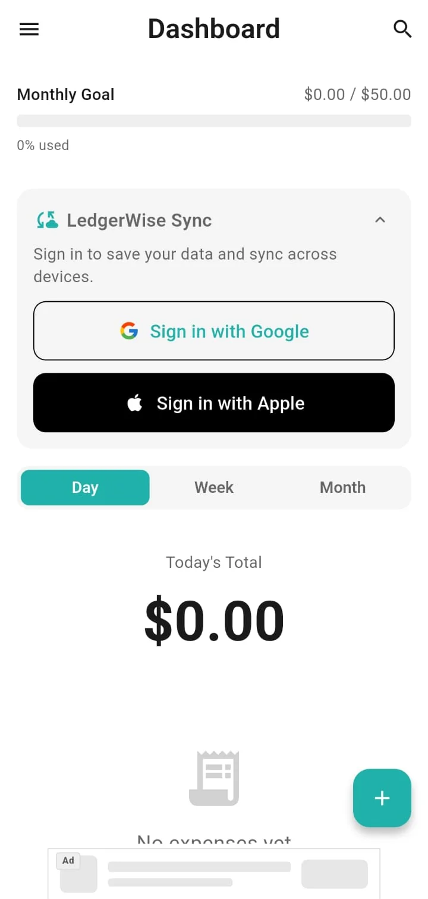</td>
    <td>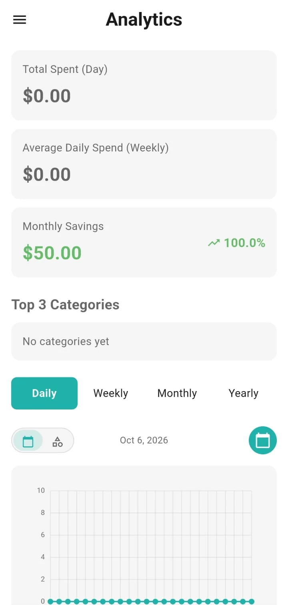</td>
  </tr>
</table>
Real screenshots from the Android app, taken on a fresh install with no entries.

---

## Get the App

  
  

## Product at a Glance

| | |
|---|---|
| **What it is** | Expense tracker built around fast entry and a monthly spending goal |
| **Platforms** | iOS and Android (Flutter), with native bridges where each OS needs them |
| **Data** | Local-first Hive store; optional Google or Apple sign-in syncs through Firestore |
| **Insights** | Day / week / month dashboard, daily-weekly-monthly-yearly analytics with date and category charts |
| **Export** | CSV (Excel-friendly) and A4 PDF reports for a chosen date range |
| **Reminders** | Daily logging reminder, weekly summary, monthly savings notification |
| **Monetisation** | Premium subscription (no ads, exports), remotely controlled ads |
| **Languages** | 15 UI languages, including Arabic and Urdu |
| **Code size** | About 51k lines of Dart, plus Swift and Kotlin native code |

## Product Showcase

<table>
  <tr>
    <td align="center">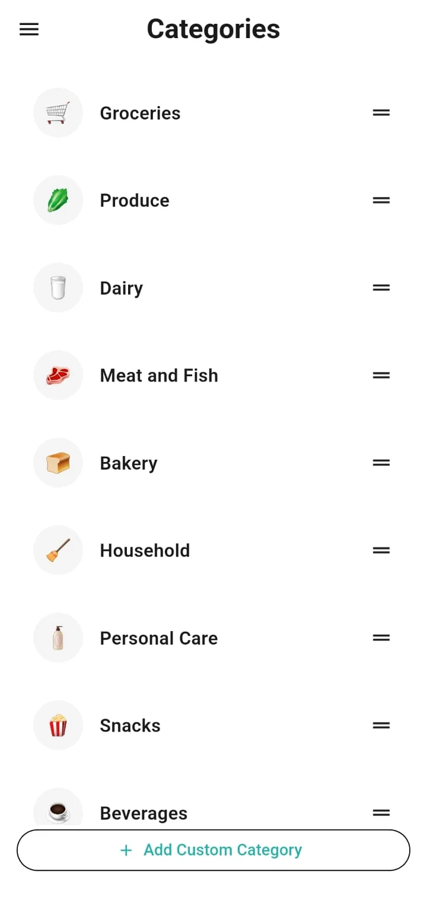 <b>Categories</b> Defaults plus custom, reorderable</td>
    <td align="center">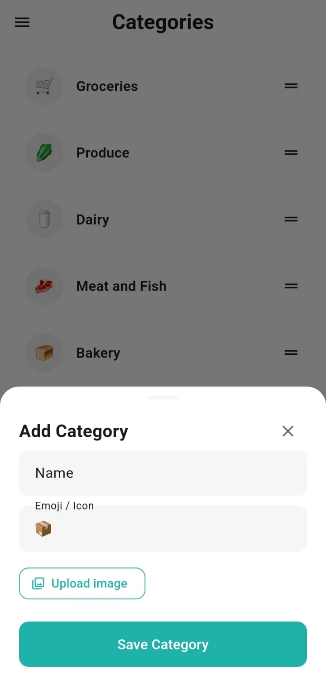 <b>Custom category</b> Emoji or uploaded image</td>
    <td align="center">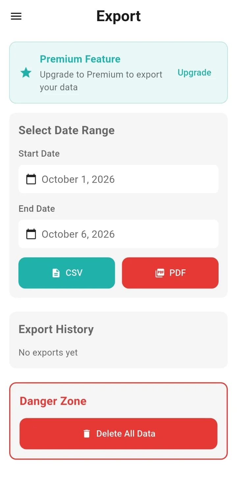 <b>Export</b> Date range, CSV or PDF</td>
    <td align="center">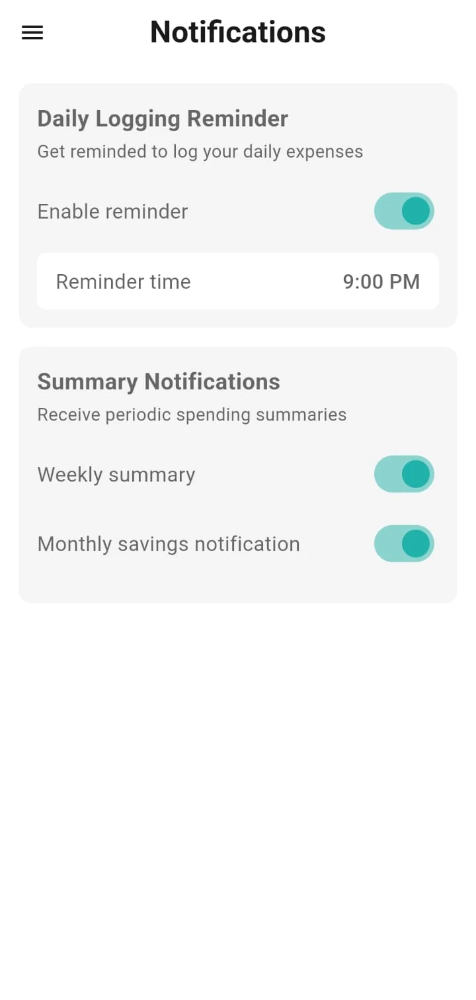 <b>Reminders</b> Daily, weekly, monthly</td>
  </tr>
  <tr>
    <td align="center">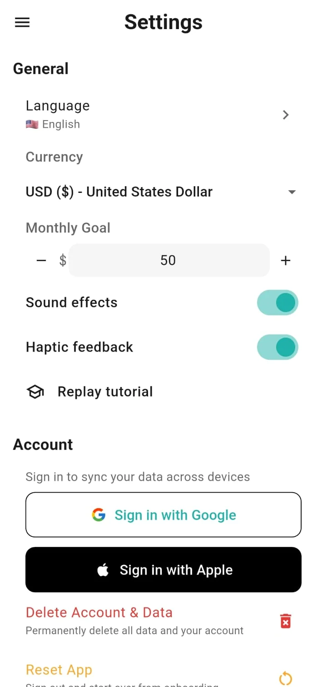 <b>Settings</b> Language, currency, goal, account</td>
    <td align="center">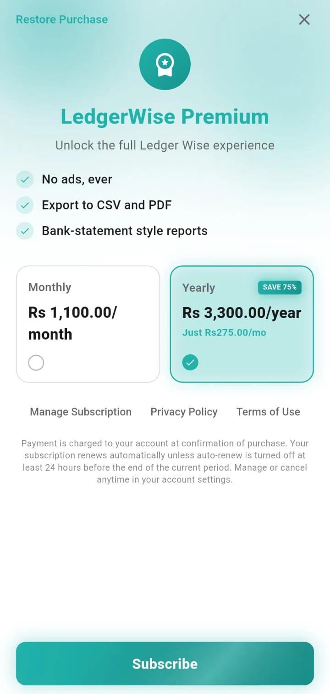 <b>Premium</b> Monthly and yearly plans</td>
    <td align="center">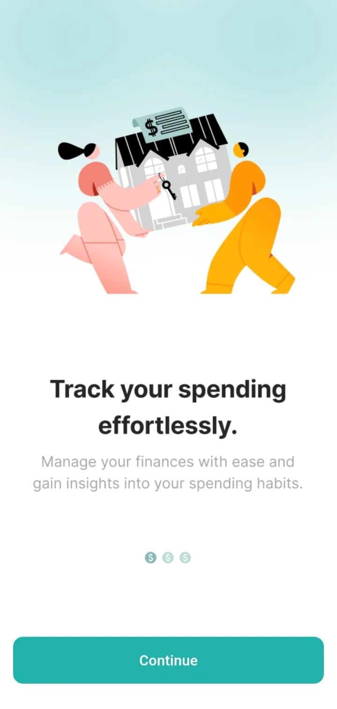 <b>Onboarding</b> Welcome</td>
    <td align="center">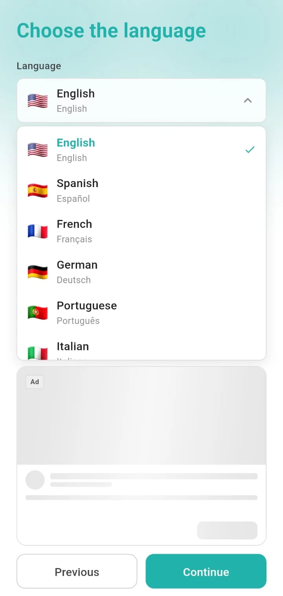 <b>Language</b> 15 languages</td>
  </tr>
</table>

## Key Features

- **Quick entry.** Item, price, quantity, category, date and an optional note, with the total computed from price and quantity.
- **Goal tracking.** A monthly goal with a progress bar on the dashboard; the dashboard switches between day, week and month totals.
- **Analytics.** Daily, weekly, monthly and yearly periods with summary cards, a time-series chart and a per-category chart, drawn with custom painters.
- **Categories.** Localised defaults plus custom categories with an emoji or an uploaded image, reordered by drag.
- **Export.** CSV and PDF for any date range, with an export history. Both are Premium features.
- **Currency and language.** Any ISO currency through a picker; 15 interface languages.
- **Reminders.** A daily "log your expenses" reminder with a chosen time, a weekly summary and a monthly savings notification.
- **Accounts.** Optional Google and Apple sign-in. Signed-in data syncs live across devices; users can reset the app or delete their account and data.
- **Guided tour.** A first-run coach-mark tour that recovers if the user taps elsewhere first.

## Engineering Highlights

### Local-first data with a cloud source of truth
- **Problem:** the app must work instantly and offline, yet follow the user across devices once they sign in.
- **Approach:** typed Hive boxes hold expenses, categories and settings. On sign-in the sync service downloads the cloud copy (or uploads the local data when the cloud is empty), then opens live listeners that merge remote changes into Hive without overwriting everything. Default categories are re-asserted after every sync, and sign-out wipes local data for a clean slate.
- **Outcome:** guests and signed-in users share one local model, and changes on another device appear without a restart.

### Billing that differs by platform
- **Problem:** the two stores behave differently, and Play returns a separate product entry per offer, each showing only its first pricing phase (which is "Free" for a trial).
- **Approach:** iOS uses a native Swift StoreKit bridge over a method and event channel; Android uses the Play billing plugin. A plan model collapses base-plan and free-trial entries into the real renewal price plus the right offer tokens, so the paywall can show the trial and the true price.
- **Outcome:** one platform-agnostic billing service, with the paywall reading from a single normalised plan.

### ATT prompt that survives cold launch
- **Problem:** on a genuine cold start, asking for tracking authorisation from Dart can reach iOS before the key window exists, and iOS then resolves it as "not determined" without ever showing the dialog.
- **Approach:** a native trigger fires when the app becomes active, independent of the Flutter engine, with de-duplication so later foregrounds are no-ops.
- **Outcome:** the system prompt appears reliably on first launch.

### Reminders that do not depend on the app being open
- **Problem:** daily, weekly and monthly reminders must fire on schedule across restarts.
- **Approach:** on Android, native WorkManager workers and notification channels handle scheduling, with a native permission request; on iOS, scheduled local notifications. A single call site wraps scheduling so a platform-channel failure is caught instead of leaking into unrelated screens.
- **Outcome:** reminders are scheduled natively and failures are contained and reported.

More: [docs/ENGINEERING_CHALLENGES.md](docs/ENGINEERING_CHALLENGES.md).

## Architecture

  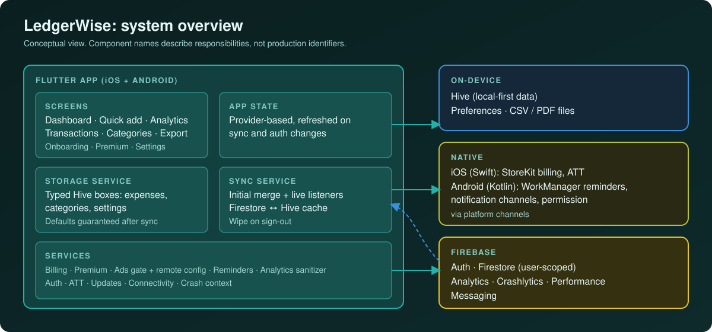

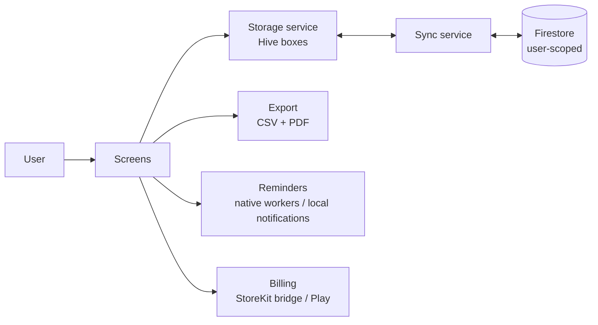

Details: [docs/ARCHITECTURE.md](docs/ARCHITECTURE.md).

## Technology Stack

| Layer | Technology |
|---|---|
| App | Flutter / Dart 3, `provider` |
| Local data | Hive with generated adapters, `shared_preferences` |
| Cloud | Firebase Auth, Firestore, Messaging, Analytics, Crashlytics, Performance |
| Sign-in | Google; Apple (vendored fork for an iPad presentation fix) |
| Export | `csv`, `pdf`, `share_plus` |
| Billing | Native Swift StoreKit bridge (iOS), `in_app_purchase` (Android) |
| Ads | Mediation SDK with remote placement config |
| Notifications | Kotlin WorkManager workers (Android), `flutter_local_notifications` (iOS), timezone-aware scheduling |
| Native | Swift (billing, ATT), Kotlin (reminders, permissions, splash) |
| Tooling | R8 minification and shrinking, generated localisation |

## Documentation

| Read | For |
|---|---|
| [Technical case study](docs/TECHNICAL_CASE_STUDY.md) | End-to-end write-up |
| [Architecture](docs/ARCHITECTURE.md) | Layers, flows and diagrams |
| [Engineering challenges](docs/ENGINEERING_CHALLENGES.md) | Problem, approach, trade-offs, outcome |
| [Product overview](docs/PRODUCT_OVERVIEW.md) | Features, screens and flows |
| [Privacy and source](docs/PRIVACY_AND_SOURCE.md) | What is and is not published |

## Source Code

This repository is a portfolio showcase for a production application. Production source code is maintained privately. See [RIGHTS.md](RIGHTS.md) for usage terms.
