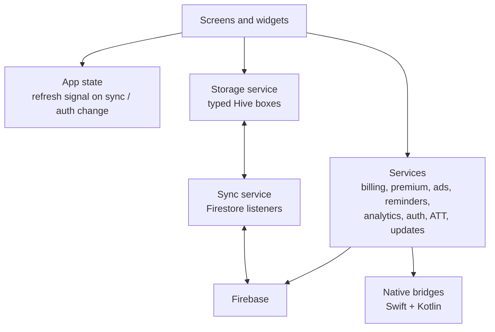
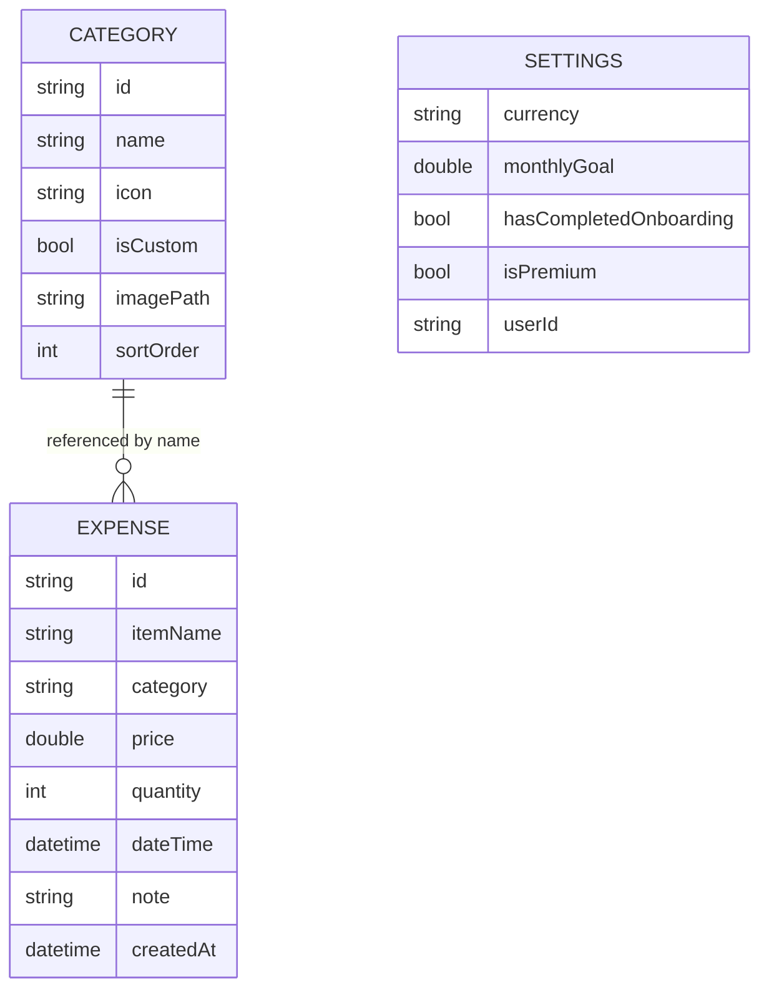
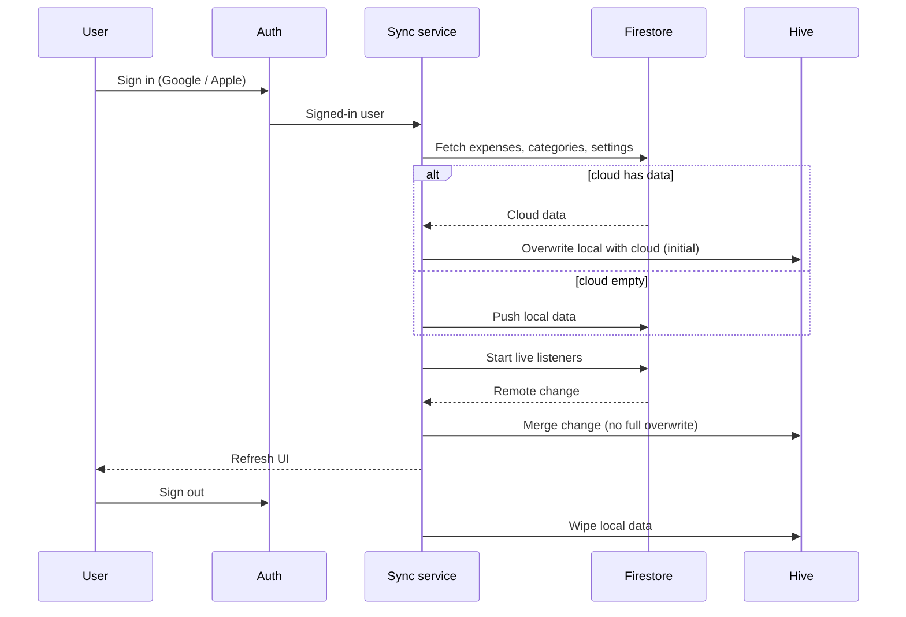
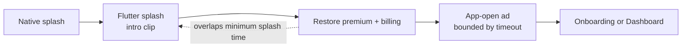
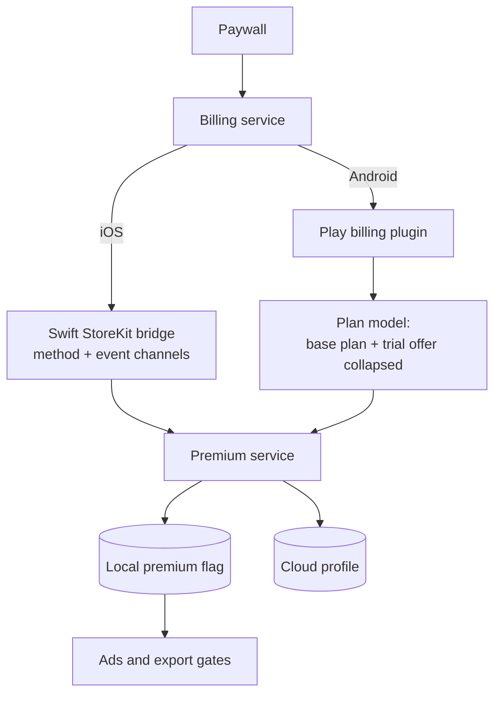

# Architecture

All diagrams are original and conceptual. They describe responsibilities, not production class or file names.

## 1. Layers

The UI reads and writes through the storage service. Everything else (sync, billing, ads, reminders) sits beside it as a service so a screen never talks to an SDK directly.

## 2. Data model

An expense's total is price multiplied by quantity. Categories are referenced from expenses by category value, and defaults are guaranteed to exist after any sync.

## 3. Sync

Firestore is the source of truth while signed in; Hive is a local cache that also serves guests. Security rules scope all reads and writes to documents under the signed-in user's own id.

## 4. Startup

The ad is bounded by a timeout and every failure path falls through to the reveal, so access to the app is never blocked behind an ad.

## 5. Billing

Premium state is stored locally and mirrored to the cloud profile. A change notifies listeners, so ads and upgrade prompts disappear immediately.

## 6. Reminders

On Android, daily, weekly and monthly reminders run as native WorkManager workers with their own notification channels and a native permission request. On iOS they are scheduled local notifications. One wrapper is the single call site for scheduling and cancelling, so a platform failure is caught and reported there.
