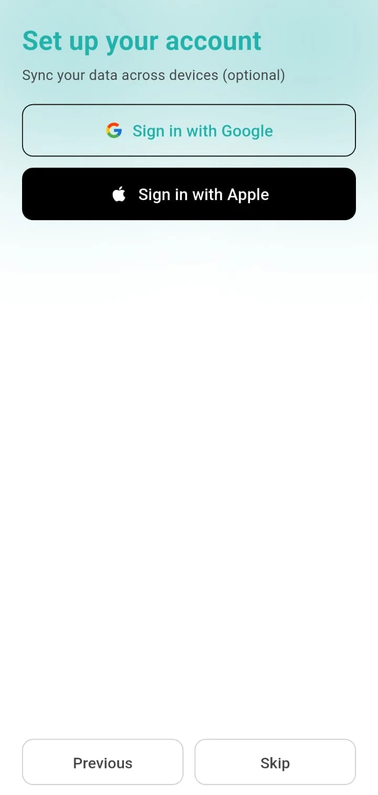

# Product Overview

All screenshots on this page are real captures from the Android app, taken on a fresh install, with system status bars removed. The app is available on the [App Store](https://apps.apple.com/pk/app/ledger-wise/id6756644842) and [Google Play](https://play.google.com/store/apps/details?id=com.ledgerwise.app&hl=en).

## What it is

LedgerWise is a deliberately small expense tracker. The goal is to record a purchase in a few taps and see where the month stands against a spending goal. It does not model bank accounts, balances or income; it tracks spending by item and category.

## First run

A short onboarding picks the language, explains the product, offers optional sign-in to sync, and sets reminders and a spending goal and currency. Sign-in can be skipped; everything works locally.

<table>
  <tr>
    <td align="center"> Language</td>
    <td align="center"> Welcome</td>
    <td align="center"> Optional sign-in</td>
  </tr>
</table>

## Day-to-day use

- **Dashboard.** Shows the monthly goal as a progress bar, a sync card for guests, a Day / Week / Month selector, the total for the selected period and the list of entries grouped by day. A floating button opens quick add.
- **Quick add.** Item name, price, quantity, category, date and time, an optional note, and a live total.
- **Categories.** A set of localised default categories (for example groceries, produce, dairy, bakery, household, personal care, snacks, beverages) plus custom ones with an emoji or uploaded image, reordered by dragging.
- **Analytics.** Daily, weekly, monthly and yearly periods. Summary cards (total spent, average daily spend, monthly savings), the top categories, and a chart that toggles between by-date and by-category views.

<table>
  <tr>
    <td align="center"> Dashboard</td>
    <td align="center"> Analytics</td>
    <td align="center"> Categories</td>
    <td align="center"> Add category</td>
  </tr>
</table>

## Export, reminders and settings

- **Export.** Choose a start and end date, then create a CSV (opens cleanly in spreadsheet apps) or an A4 PDF report. An export history lists past exports. Both formats are Premium features.
- **Reminders.** A daily reminder at a chosen time, a weekly summary and a monthly savings notification.
- **Settings.** Language, currency, monthly goal, sound effects, haptic feedback, replay tutorial, account actions (sign in, delete account and data, reset app).

<table>
  <tr>
    <td align="center"> Export</td>
    <td align="center"> Reminders</td>
    <td align="center"> Settings</td>
  </tr>
</table>

## Accounts and sync

Google and Apple sign-in are optional. Signed-in users' data syncs through a per-user cloud store; signing out clears the local copy so a shared device starts clean. Users can reset the app, or permanently delete their account and data.

## Monetisation

Free use is supported by ads, which can be switched off remotely. Premium removes ads and unlocks CSV and PDF export. On Android it is offered as monthly and yearly subscriptions with free-trial offers; on iOS the code sells a monthly plan.

## Localisation

Fifteen languages: English, Arabic, German, Spanish, French, Hindi, Italian, Japanese, Korean, Portuguese, Russian, Turkish, Urdu, Vietnamese and Chinese.

Continue with the [technical case study](TECHNICAL_CASE_STUDY.md).
